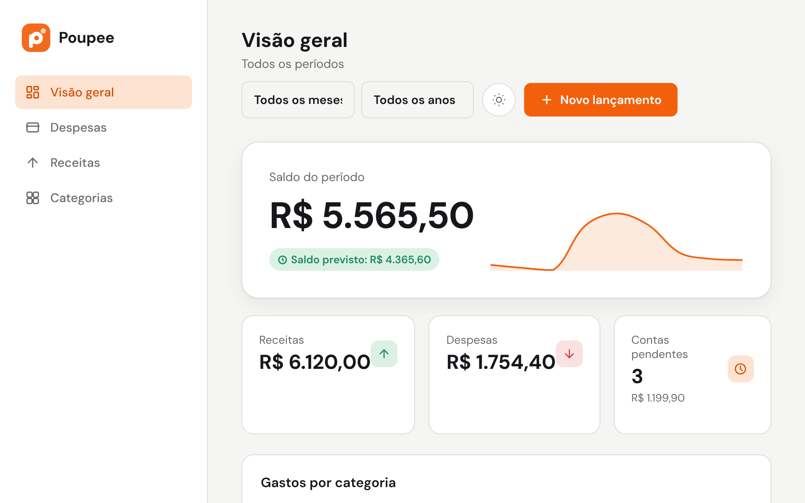
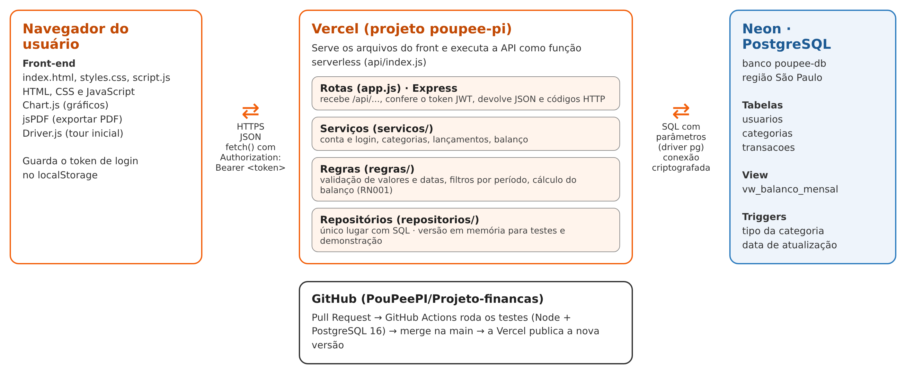
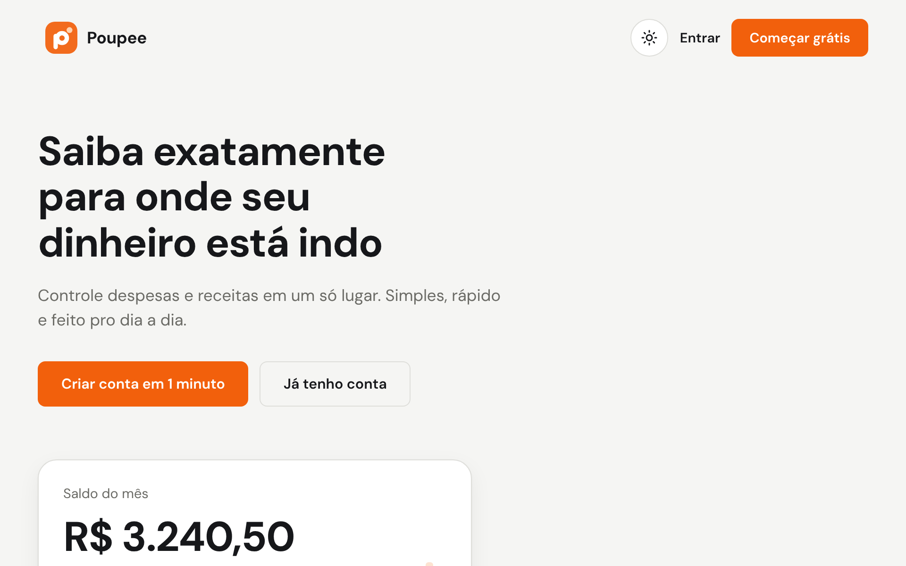
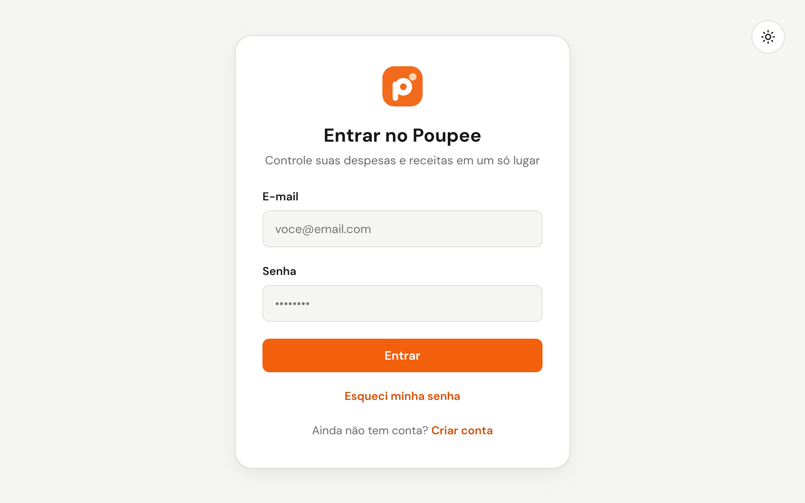
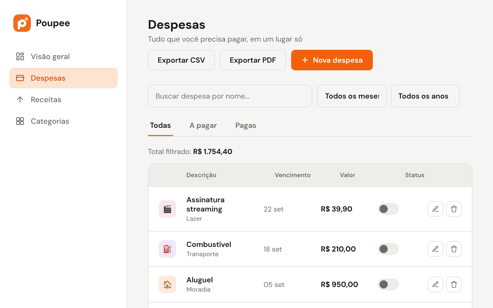
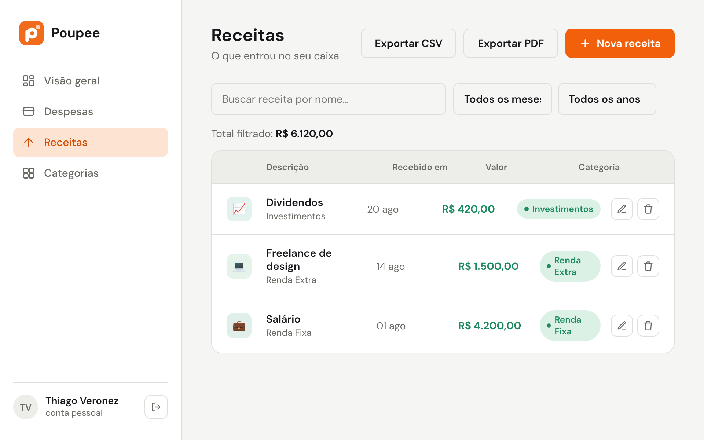
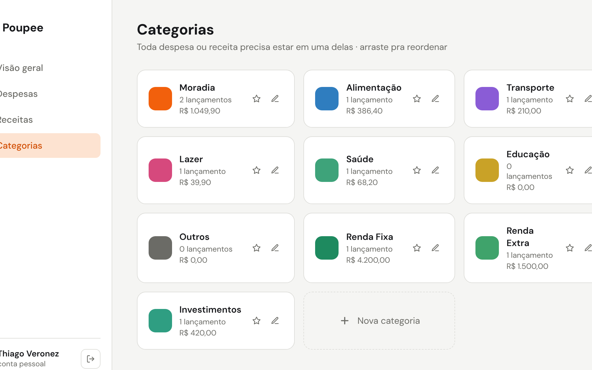
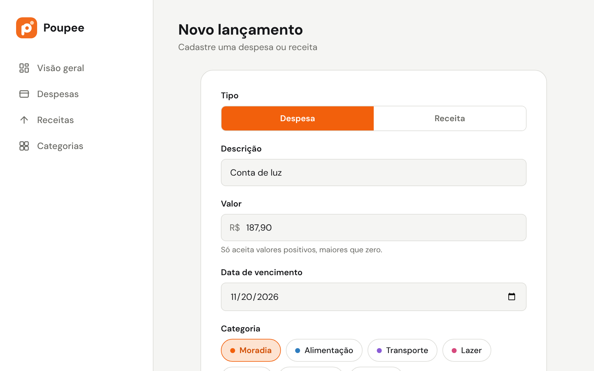

<p align="center">
  
</p>

<h1 align="center">Poupee: organizador de finanças</h1>

<p align="center">
  Controle despesas e receitas em um só lugar e saiba exatamente para onde seu dinheiro está indo.
</p>

<p align="center">
  <a href="https://poupee-pi.vercel.app"><strong>Abrir o Poupee (poupee-pi.vercel.app)</strong></a>
  ·
  <a href="docs/requisitos.md">Requisitos</a>
  ·
  <a href="backend/README.md">API</a>
  ·
  <a href="https://youtu.be/EKjECa7p4eM">Vídeo de demonstração</a>
  ·
  <a href="docs/documentacao-poupee.pdf">Documentação (PDF)</a>
  ·
  <a href="docs/decisoes.md">Decisões</a>
</p>

<p align="center">
  Login de exemplo: <strong>thiago@exemplo.com</strong> / <strong>123456</strong>, ou crie a sua conta.
</p>



## Vídeo de demonstração

[](https://youtu.be/EKjECa7p4eM)

Pitch e demonstração do Poupee no YouTube: <https://youtu.be/EKjECa7p4eM>

## Sobre o projeto

Boa parte das pessoas não sabe, no fim do mês, para onde foi parte da renda: os gastos se acumulam,
contas vencem sem ninguém perceber e a planilha acaba abandonada por falta de praticidade.

O **Poupee** é um organizador de finanças pessoais para a web. O usuário cria a conta, registra
despesas e receitas em categorias, acompanha o que ainda está a pagar e vê, em um único painel,
o saldo do período e a distribuição dos gastos por categoria.

Projeto Integrador do curso de **Tecnologia em Desenvolvimento de Software Multiplataforma** da
**Fatec Franca "Dr. Thomaz Novelino"** (Centro Paula Souza), 2026.
Disciplina-chave: **Engenharia de Software II** (2º semestre).

## Equipe

- Douglas Andrade Cintra de Brito
- Eleonora Cintra Castro
- João Pedro Racero Santos
- Ryan Filipe Damasceno
- Thiago Veronez da Silva Sаntos

| Frente | Responsabilidades |
| --- | --- |
| Layout e Visão Geral | Protótipo, padrão visual, componentes e tela de Visão Geral / Balanço |
| Tela de Despesas | Cadastro, formulários, filtros, listagem e responsividade |
| Lógica do sistema | CRUD, categorias, regras de negócio, validações, filtros, balanço e integração com o banco |
| Banco de dados | Modelos conceitual e lógico, tabelas, relacionamentos e persistência |
| Organização e documentação | GitHub, tarefas, requisitos, casos de uso, diagramas e revisão |

## Funcionalidades

- [x] Criar conta e entrar com e-mail e senha (senha guardada com hash)
- [x] Cadastrar, editar e excluir despesas e receitas
- [x] Categorias próprias com nome, cor e ícone, favoritas e ordem
- [x] Marcar despesa como paga ou a pagar com um clique
- [x] Filtros por mês, ano, status e descrição
- [x] Balanço do período: saldo, saldo previsto, contas pendentes e gastos por categoria
- [x] Exportar lançamentos em CSV e PDF
- [x] Tema claro e escuro
- [x] Telas ligadas à API, com os dados salvos no banco (PostgreSQL no Neon)
- [x] Site publicado na Vercel: <https://poupee-pi.vercel.app>
- [ ] Recuperar senha por e-mail
- [ ] Conta bancária ([em discussão](docs/decisoes.md#5-conta-bancária-em-aberto))

Lista completa em [docs/requisitos.md](docs/requisitos.md).

## Tecnologias

| Camada | Tecnologia |
| --- | --- |
| Front-end | HTML, CSS e JavaScript, Chart.js, jsPDF, Driver.js (publicado na Vercel junto com a API) |
| Back-end | Node.js, Express, bcryptjs, JSON Web Token |
| Banco de dados | PostgreSQL (Neon na nuvem) |
| Testes | `node:test` (sem dependências extras) |

## Estrutura do repositório

```
.
├── index.html, script.js, styles.css   front-end (conversa com a API em /api)
├── api/index.js                        função da Vercel que publica a API
├── vercel.json, package.json           configuração da hospedagem na Vercel
├── backend/                            API REST (lógica do sistema)
│   ├── src/regras/                     validações, filtros e cálculo do balanço
│   ├── src/servicos/                   regras que consultam dados (conta, categorias, lançamentos)
│   ├── src/repositorios/               acesso ao PostgreSQL (e versão em memória para testes)
│   └── test/                           testes automatizados
├── db/
│   ├── schema.sql                      tabelas, triggers e view do balanço
│   └── seed.sql                        dados de exemplo
├── docs/
│   ├── documentacao-poupee.pdf/.docx   documentação completa do PI (requisitos, modelagem, arquitetura, API, implantação)
│   ├── requisitos.md                   requisitos, regras de negócio e casos de uso
│   ├── decisoes.md                     registro de decisões do projeto
│   └── img/                            diagramas e telas
└── CONTRIBUTING.md                     guia de Git do time
```

## Como rodar

### Jeito mais rápido (sem banco)

```bash
cd backend
npm install
npm run dev:memoria                # abre em http://localhost:3000
```

A API também serve o front, então é só abrir <http://localhost:3000>.
Os dados ficam em memória e somem quando o servidor reinicia.

### Banco de dados

Com o PostgreSQL instalado:

```bash
createdb poupee
psql -d poupee -f db/schema.sql
psql -d poupee -f db/seed.sql      # opcional: dados de exemplo
```

Se o banco estiver vazio, a API também cria as tabelas e os dados de exemplo sozinha ao subir.

### API

Precisa do Node.js 18 ou mais novo.

```bash
cd backend
npm install
cp .env.example .env               # ajuste o banco (DATABASE_URL ou DB_*) e o JWT_SEGREDO
npm start                          # site em http://localhost:3000, API em /api
```

Se preferir o Live Server do VS Code para o front, deixe a API rodando: o front aponta sozinho para `http://localhost:3000/api`.

Login de exemplo (seed e modo memória): **thiago@exemplo.com** / **123456**.

Os endpoints, o formato das respostas e as regras estão em [backend/README.md](backend/README.md).

### Publicar na Vercel

O site oficial está em **<https://poupee-pi.vercel.app>**: projeto `poupee-pi` na Vercel, publicado a partir
da branch `main` (cada PR mesclado vira um deploy novo), com o banco `poupee-db` no Neon (região São Paulo).
Para conferir se está tudo no ar, abra <https://poupee-pi.vercel.app/api/saude>: deve aparecer `"modo":"postgres"`.

Para montar do zero (por exemplo, numa conta nova):

O mesmo projeto da Vercel publica o front e a API (a função `api/index.js` atende tudo em `/api`).

1. **Projeto na Vercel.** Importe o repositório. Deixe **Root Directory** vazio (a raiz do repositório,
   não `backend/`) e **Framework Preset** como *Other*.
2. **Banco (Neon).** No projeto da Vercel, abra a aba **Storage → Create Database → Neon** e conecte ao projeto.
   A integração cria a variável `DATABASE_URL` sozinha. (Se já tiver um banco no Neon, dá para colar a
   *connection string* dele em `DATABASE_URL` em *Settings → Environment Variables*.)
3. **Segredo do login.** Em *Settings → Environment Variables*, crie `JWT_SEGREDO` com um texto longo e aleatório.
4. Faça um **Redeploy**. Na primeira conexão com o banco vazio, a API cria as tabelas de `db/schema.sql`
   e os dados de exemplo de `db/seed.sql`. Para conferir, abra `https://<seu-projeto>.vercel.app/api/saude`:
   deve aparecer `"modo":"postgres"`.

Sem `DATABASE_URL`, a Vercel sobe em **modo demonstração** (`"modo":"memoria"`): funciona com o login de exemplo,
mas os dados podem sumir a qualquer momento. Serve para testar, não para usar de verdade.

Use sempre o endereço da Vercel: uma cópia no GitHub Pages teria só o front, sem a API, e não conseguiria entrar.

### Testes

```bash
cd backend
npm test
```

## Arquitetura



## Modelagem

| Processo (BPMN) | Casos de uso |
| --- | --- |
|  |  |

**Modelo entidade-relacionamento:** um usuário tem várias categorias e vários lançamentos; cada
lançamento pertence a uma categoria do mesmo tipo (despesa ou receita).


### Principais regras de negócio

- **Saldo do período** = receitas − despesas pagas; **saldo previsto** = receitas − todas as despesas.
- Valores sempre maiores que zero.
- Todo lançamento tem uma categoria, e ela precisa ser do mesmo tipo do lançamento.
- Só despesas têm status (a pagar / paga); receitas contam como recebidas.
- Um e-mail por conta; categoria com lançamentos não pode ser excluída.

## Telas

| | |
| --- | --- |
|  |  |
|  |  |
|  |  |

## Próximos passos

- Lembretes de contas a vencer
- Lançamentos recorrentes
- Metas de gastos por categoria

## Como contribuir

Veja o [guia de Git do time](CONTRIBUTING.md). Toda mudança entra por Pull Request, e os testes
rodam automaticamente no GitHub.

## Licença

[MIT](LICENSE)
